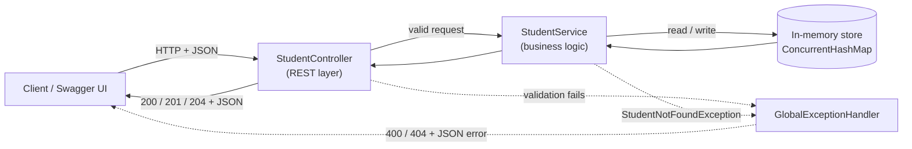
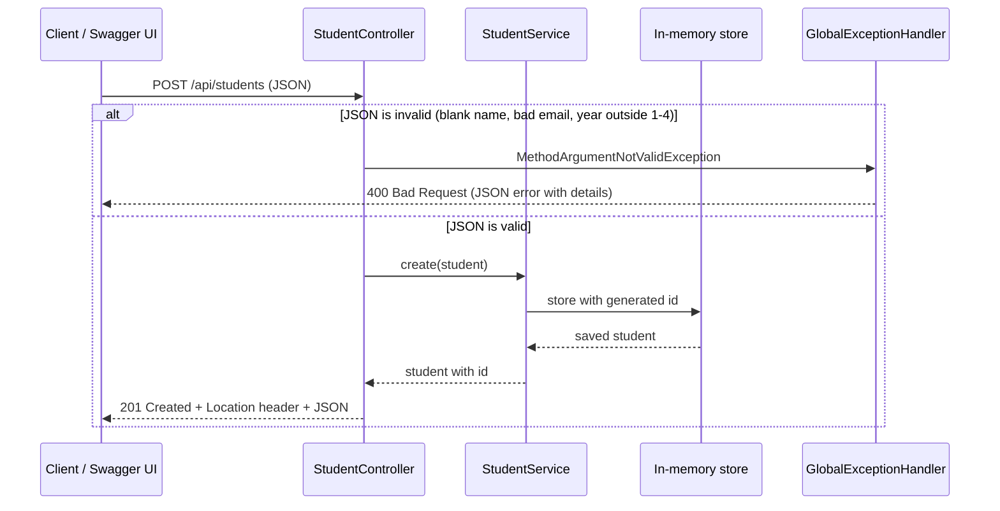
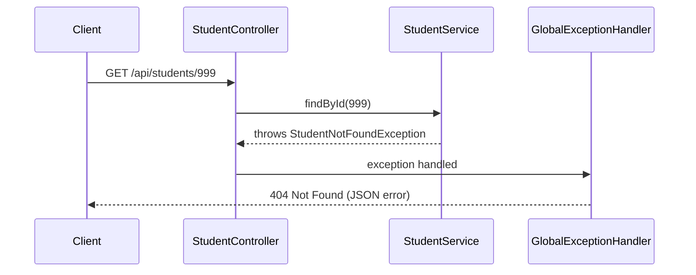

# Architecture – StudentManagementAPI

The application has three layers plus a global error handler. There is **no database**: students are kept in a `ConcurrentHashMap` inside the running application, so all data is lost when it stops.

## Diagram (component view)

Ready-made images of the same diagram are in [`architecture.svg`](architecture.svg) and [`architecture.png`](architecture.png) (open it in a browser, or insert it into your report).

Solid arrows are the success path. Dotted arrows are the error path.

## Request–response flow (create a student)

## Not-found path (get / update / delete by id)

## Components in simple terms

| Component | File | Role |
|---|---|---|
| Client / Swagger UI | browser | Sends HTTP requests and shows the responses. |
| `StudentController` | `controller/StudentController.java` | Receives HTTP requests, checks input with `@Valid`, calls the service, chooses the status code. |
| `StudentService` | `service/StudentService.java` | Contains the actual create/read/update/delete logic. Throws `StudentNotFoundException` if an id is missing. |
| `Student` | `model/Student.java` | The data (id, name, email, department, year) and its validation rules. |
| In-memory store | `ConcurrentHashMap` inside `StudentService` | Holds students while the app runs. An `AtomicLong` generates unique ids. |
| `GlobalExceptionHandler` | `exception/GlobalExceptionHandler.java` | Converts exceptions into clean JSON errors (no stack traces). |
| `ErrorResponse` | `exception/ErrorResponse.java` | The JSON shape of every error. |
| `OpenApiConfig` | `config/OpenApiConfig.java` | Title and description shown in Swagger UI. |

## Why the structure differs slightly from the task brief

Two small additions to the suggested layout: `exception/ErrorResponse.java` (one consistent error JSON shape) and `config/OpenApiConfig.java` (Swagger title/description). Everything else matches the brief.
